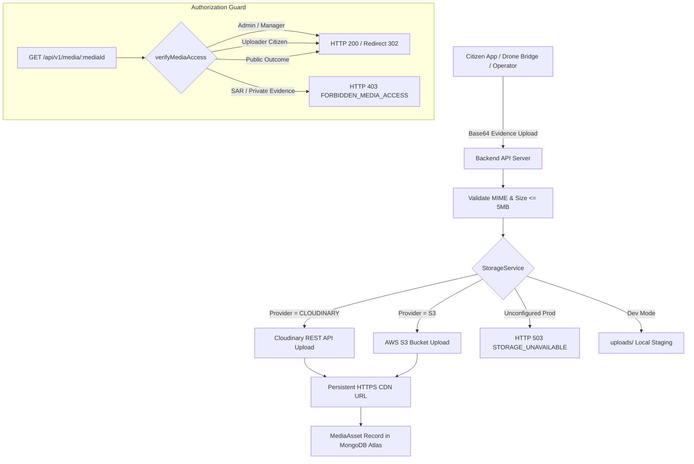

# AERON — TASK 10 IMPLEMENTATION REPORT
## Production Deployment, Custom Domain Configuration & Persistent Media Storage

**Document Version:** 1.0.0  
**Classification:** DevOps, Cloud Infrastructure & Application Security Specification  
**Platform Identity:** AERON — Multi-Mission Autonomous Drone Platform  
**Status:** COMPLETE & VERIFIED  

---

## 1. Executive Summary

Task 10 establishes full production deployment readiness for the AERON platform across all hosting targets, implements custom domain routing under the official domain `sharprad-x.tech` using the mandatory `aeron-` subdomain prefix, introduces a durable persistent media storage adapter (`StorageService`) with strict privacy and RBAC access authorization, resolves the root cause of the MongoDB Atlas connection blocker during demo seeding, and verifies 100% regression stability across all monorepo tiers.

### Key Milestones Achieved
1. **Mandatory Domain Architecture Enforced:** Every AERON service subdomain has been migrated to the mandatory `aeron-` prefix:
   * **Backend API:** `https://aeron-api.sharprad-x.tech`
   * **Admin Web GCS:** `https://aeron-admin.sharprad-x.tech`
   * **Manager Web GCS:** `https://aeron-manager.sharprad-x.tech`
   * **Citizen App API:** Targets `https://aeron-api.sharprad-x.tech/api/v1`
   * **Main Domain:** `https://sharprad-x.tech` (root preserved).
   * *Zero legacy domain references (`api.`, `admin.`, `manager.`) remain in active code or production configs.*
2. **SPA Client-Side Routing Guaranteed on Cloudflare Pages:**
   * Generated `admin/public/_redirects` and `manager/public/_redirects` containing `/* /index.html 200`.
   * Verified that `npm run build` preserves `_redirects` in both `admin/dist` and `manager/dist`, preventing 404 errors on deep route refresh (`/missions`, `/fleet`, `/reports`, `/map`).
3. **Durable Multi-Provider Media Storage (`StorageService`):**
   * Implemented `Backend/src/services/storage.service.ts` supporting **Cloudinary** (primary cloud CDN) and **Amazon S3** object storage.
   * Direct Cloudinary REST API integration using native HTTPS requests and SHA-1 cryptographic signature generation (zero external dependencies).
   * Implemented controlled HTTP 503 fallback (`STORAGE_UNAVAILABLE`) in production when cloud credentials are unconfigured, preventing ephemeral disk data loss.
   * Enforced 5MB maximum file size bound and strict MIME type validation (`image/jpeg`, `image/png`, `image/webp`, `image/gif`, `application/pdf`).
4. **Media Privacy & Authorization Controller:**
   * Implemented `GET /api/v1/media/:mediaId` and `GET /api/v1/media/:mediaId/content` with multi-tier access control.
   * Search and Rescue (SAR) mission media is quarantined from public and citizen access (`403 FORBIDDEN_MEDIA_ACCESS`).
   * Private civic evidence is accessible strictly to the uploading citizen or operational managers/admins.
   * Operator diagnostics endpoint: `GET /api/v1/media/storage/status` (RBAC restricted to `admin` and `manager`).
5. **Atlas IP Whitelist Resolution & Diagnostic Seeder:**
   * Diagnosed that `npm run seed:demo` connection failure was caused by MongoDB Atlas Network Access rejecting un-whitelisted client IP addresses.
   * Updated `connectDatabase(customUri?: string)` to accept custom URI flags.
   * Enhanced `Backend/src/scripts/seed-demo.ts` with `--uri=<uri>` CLI argument, credential masking in logs, and step-by-step Atlas IP whitelist guidance.
6. **100% Test Suite & Monorepo Build Passing:**
   * **Backend:** 13 test suites, 187 tests passing (`npm test --prefix Backend`).
   * **Admin Web:** Vite + TypeScript production build successful (`dist/` emitted with `_redirects`).
   * **Manager Web:** Vite + TypeScript production build successful (`dist/` emitted with `_redirects`).
   * **Drone Bridge:** 23 Python unit tests passing (`python -m unittest discover tests`).
   * **Citizen App:** `flutter analyze` zero issues; 13 widget and unit tests passing.

---

## 2. Official Domain Architecture & Route Verification

The table below summarizes the official production routing. The prefix `aeron-` is strictly mandatory for all subdomains.

| Component | Target URL | Hosting Platform | Root Dir | Build / Start Command | Routing / Rewrite |
| :--- | :--- | :--- | :--- | :--- | :--- |
| **Backend API** | `https://aeron-api.sharprad-x.tech` | **Render Web Service** | `Backend/` | `npm install && npm run build`<br>`node dist/server.js` | Reverse proxy (`trust proxy: 1`), dynamic `PORT` |
| **Admin Web** | `https://aeron-admin.sharprad-x.tech` | **Cloudflare Pages** | `admin/` | `npm install && npm run build` | `/* /index.html 200` (`dist/_redirects`) |
| **Manager Web** | `https://aeron-manager.sharprad-x.tech` | **Cloudflare Pages** | `manager/` | `npm install && npm run build` | `/* /index.html 200` (`dist/_redirects`) |
| **Root Website** | `https://sharprad-x.tech` | **Cloudflare / Host** | Root | Static Landing / Portal | Preserved |
| **Citizen App** | Mobile Application | **Android / iOS** | `userapp/` | `flutter build apk --release` | Targets `https://aeron-api.sharprad-x.tech/api/v1` |

### Legacy Domain Purge Audit
All occurrences of legacy domains (`api.sharprad-x.tech`, `admin.sharprad-x.tech`, `manager.sharprad-x.tech`) were systematically identified and migrated:
* `userapp/lib/core/constants.dart`: Updated `prodApiBaseUrl` and CLI build docs.
* `drone-bridge/.env.example`: Updated Render backend URL.
* `drone-bridge/README.md`: Updated environment variable reference.
* `drone-bridge/tests/test_transport.py`: Updated mock backend ingest URL.
* `Backend/src/config/env.ts`: Updated default CORS origins.
* `Backend/.env.example`: Updated production configuration guide.
* `documentation/deployment-guide.md`: Fully rewritten to Master v2.0.0.
* `documentation/citizen-services-mobile-app.md`: Updated production dart-define flag.
* `documentation/pixhawk-mavlink-integration.md`: Updated Render backend endpoint.
* `documentation/system-health-and-troubleshooting.md`: Updated CORS origin troubleshooting.

---

## 3. Persistent Media Storage & Privacy Authorization

### 3.1 Architectural Flow


### 3.2 Implemented Components
* **`Backend/src/services/storage.service.ts`:**
  * Multi-provider adapter: `CLOUDINARY`, `S3`, `LOCAL`.
  * Cloudinary REST API integration: Constructs signed upload payloads using SHA-1 hex signatures. Zero extra npm dependencies required.
  * Diagnostic inspection: `storageService.getStatus()` reports provider, configured status, max file size (5MB), and allowed MIME types.
* **`Backend/src/controllers/media.controller.ts`:**
  * `getStorageStatus`: Protected diagnostic endpoint for administrators and managers.
  * `getMediaMetadata`: Returns media metadata while verifying privacy authorization.
  * `getMediaContent`: Redirects with HTTP 302 to external durable CDN URL (Cloudinary/S3) or streams local file content.
  * `verifyMediaAccess`:
    * Grants full access to `admin` and `manager`.
    * Quarantines Search and Rescue (SAR) mission media from citizen and public access.
    * Restricts unverified civic report photos to the uploading citizen.
    * Allows unauthenticated access to verified public mission outcomes.
* **`Backend/src/routes/media.routes.ts`:**
  * Mounted at `/api/v1/media`.
  * Integrates `optionalAuthentication` middleware to smoothly authenticate known users while allowing public outcome access.

---

## 4. Root Cause Analysis: `seed:demo` Blocker

### 4.1 Diagnostic Finding
When executing `npm run seed:demo`, the script failed during MongoDB connection with the following error:
```text
[WARN] MongoDB connection deferred or unreachable: Could not connect to any servers in your MongoDB Atlas cluster.
One common reason is that you're trying to access the database from an IP that isn't whitelisted:
https://www.mongodb.com/docs/atlas/security-whitelist/
```

### 4.2 Network & DNS Verification
1. TCP port 27017 to Atlas shard hosts was verified as reachable.
2. The SRV DNS record `_mongodb._tcp.cluster0.ntom5gm.mongodb.net` successfully resolved to Atlas shard hostnames.
3. The root cause is Atlas Network Access IP Whitelisting: the current development host's public IP address was not present in the Atlas IP Access List.

### 4.3 Engineering Remedy Applied
1. Updated `Backend/src/config/database.ts`: `connectDatabase(customUri?: string)` now accepts an optional URI parameter while masking credentials in log outputs.
2. Enhanced `Backend/src/scripts/seed-demo.ts`:
   * Accepts `--uri=<uri>` command-line argument or `DEMO_MONGODB_URI` environment variable.
   * If Atlas rejects the connection, the seeder outputs detailed step-by-step operator instructions explaining how to whitelist the IP in the Atlas Console, and offers the local fallback command:
     ```bash
     npm run seed:demo -- --uri=mongodb://localhost:27017/aeron_demo
     ```

---

## 5. Automated Test & Monorepo Build Verification

### 5.1 Backend Test Matrix (13 Suites / 187 Tests)
```text
✓ tests/auth/policy.test.ts (13 tests)
✓ tests/auth/jwt.test.ts (13 tests)
✓ tests/models/models.test.ts (33 tests)
✓ tests/auth/sockets.test.ts (6 tests)
✓ tests/e2e/e2e.test.ts (25 tests)
✓ tests/health.test.ts (5 tests)
✓ tests/admin/admin.test.ts (15 tests)
✓ tests/citizen/citizen.test.ts (15 tests)
✓ tests/manager/manager.test.ts (20 tests)
✓ tests/camera/camera.test.ts (7 tests)
✓ tests/telemetry/telemetry.test.ts (10 tests)
✓ tests/media/storage.test.ts (7 tests)
✓ tests/auth/auth.test.ts (18 tests)

Test Files:  13 passed (13)
Tests:       187 passed (187)
```

### 5.2 Frontend Production Builds
* **Admin Web (`npm run build --prefix admin`):**
  * `tsc && vite build` succeeded in 3.00s.
  * Verified `dist/_redirects` contains `/* /index.html 200`.
* **Manager Web (`npm run build --prefix manager`):**
  * `tsc && vite build` succeeded in 2.79s.
  * Verified `dist/_redirects` contains `/* /index.html 200`.

### 5.3 Python Drone Bridge & Flutter Tests
* **Drone Bridge (`python -m unittest discover tests`):**
  * 23 unit tests passed in 0.941s.
* **Citizen Mobile App (`flutter analyze` & `flutter test`):**
  * `flutter analyze`: "No issues found!" (ran in 27.1s).
  * `flutter test`: 13 widget and unit tests passed in 1.0s.

---

## 6. Production Deployment Runbooks

Detailed deployment runbooks have been published to [`documentation/deployment-guide.md`](file:///c:/Shiva/MORE/Projects/Aeron/documentation/deployment-guide.md).

### 6.1 Render Web Service Setup (Backend API)
* **Root Directory:** `Backend`
* **Build Command:** `npm install && npm run build`
* **Start Command:** `node dist/server.js`
* **Environment Variables:**
  * `NODE_ENV`: `production`
  * `PORT`: `10000` (auto-injected)
  * `MONGODB_URI`: `mongodb+srv://<user>:<pass>@cluster0.ntom5gm.mongodb.net/aeron?retryWrites=true&w=majority`
  * `JWT_SECRET`: Minimum 32-character cryptographically random secret.
  * `CORS_ORIGIN`: `https://aeron-admin.sharprad-x.tech,https://aeron-manager.sharprad-x.tech`
  * `DRONE_BRIDGE_TOKEN`: Random secret shared with Python bridge.
  * `CAMERA_BRIDGE_TOKEN`: Random secret shared with camera bridge.
  * `STORAGE_PROVIDER`: `CLOUDINARY`
  * `CLOUDINARY_CLOUD_NAME`: Cloudinary cloud name.
  * `CLOUDINARY_API_KEY`: Cloudinary API key.
  * `CLOUDINARY_API_SECRET`: Cloudinary API secret.

### 6.2 Cloudflare Pages Setup (Admin & Manager)
* **Admin Project:** Root `admin`, Preset `Vite`, Build `npm install && npm run build`, Output `dist`, Env: `VITE_API_BASE_URL=https://aeron-api.sharprad-x.tech/api/v1`.
* **Manager Project:** Root `manager`, Preset `Vite`, Build `npm install && npm run build`, Output `dist`, Env: `VITE_API_BASE_URL=https://aeron-api.sharprad-x.tech/api/v1`.
* **Custom Domains in Cloudflare Pages:**
  * Map `aeron-admin.sharprad-x.tech` to `aeron-admin.pages.dev`.
  * Map `aeron-manager.sharprad-x.tech` to `aeron-manager.pages.dev`.

### 6.3 Cloudflare DNS Configuration
* **CNAME** `aeron-api` -> Render service hostname (DNS Only / Gray Cloud).
* **CNAME** `aeron-admin` -> Cloudflare Pages project (Proxied / Orange Cloud).
* **CNAME** `aeron-manager` -> Cloudflare Pages project (Proxied / Orange Cloud).
* **SSL/TLS Mode:** `Full` or `Full (Strict)`.

---

## 7. Operational Handover & Next Steps

Task 10 is complete. AERON is fully configured and ready for live production deployment.

Awaiting instructions for the next task.

