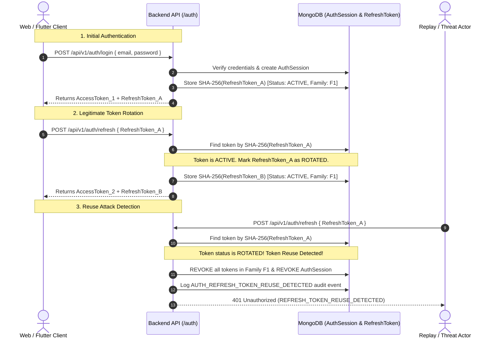

# AERON — Authentication, JWT Security & Role-Based Access Control (RBAC) Architecture

This specification document details the centralized authentication, JWT issuance, opaque refresh token rotation, session management, Socket.IO handshake security, and backend-enforced Role-Based Access Control for **AERON — Multi-Mission Autonomous Drone Platform**.

---

## 1. Role Definitions & Access Responsibilities

The AERON security model enforces three canonical roles across all client applications. These strings are immutable and authoritative:

| Role String | Target Application | Operational Scope & Responsibilities |
|---|---|---|
| **`admin`** | **Admin Web (`GCS-SYS`)** | Full system access: physical drone airframe configuration, hardware bus diagnostics, raw MAVLink stream inspection, system-level audits, and administrator/manager provisioning. |
| **`manager`** | **Manager Web (`GCS v4.2 PRO`)** | Mission flight deck: 4 operational verticals (`CIVIC_ISSUE_VERIFICATION`, `CROWD_SAFETY`, `MICRO_CLIMATE`, `SUBTERRANEAN_SEARCH_RESCUE`), mission creation, sortie assignment, assigned drone telemetry monitoring, evidence audit, and outcome approval. |
| **`citizen`** | **Citizen Mobile App** | Public civic engagement: civic issue intake, geotagged evidence submission, 6-stage municipal inspection status tracking, verified outcome viewing, and personal notification alerts. |

### Strict Negative Permissions for Citizen Accounts
Backend authorization policies guarantee that `citizen` accounts are **strictly prohibited** from:
- Accessing raw drone telemetry streams or hardware diagnostics.
- Sending flight-control commands or viewing MAVLink bus packets.
- Accessing internal mission operational logs or unassigned pilot notes.
- Subscribing to telemetry Socket.IO rooms (`drone:telemetry:*`, `drone:command:*`).
- Viewing confidential search-and-rescue incident coordinates (`isConfidential: true`).
- Accessing administrative provisioning or audit endpoints.

---

## 2. Registration & Account Provisioning Policy

### 2.1. Public Citizen Registration (`POST /api/v1/auth/register`)
- **Publicly Allowed:** Yes, restricted exclusively to the `citizen` role.
- **Privilege Escalation Protection:** If a client request includes `role: 'admin'`, `role: 'manager'`, or `accountStatus`, the backend strictly ignores the client-supplied values and forces:
  ```typescript
  role: 'citizen',
  accountStatus: 'active'
  ```
- **Validation:** Normalized lowercase trimmed email, password complexity check (min 8 chars, uppercase, lowercase, numeric digit, special character).
- **Rate Limiting:** Guarded by `registerRateLimiter` (max 10 registrations per IP per hour).

### 2.2. Administrative Provisioning (`POST /api/v1/admin/users`)
- **Publicly Allowed:** **NO.**
- Protected by `requireAuthentication` AND `requireRole('admin')`.
- Only verified administrators can provision `manager` or secondary `admin` accounts.
- Every provisioning event is permanently logged in the `auditlogs` collection.

### 2.3. Initial System Administrator Bootstrap CLI
To eliminate default hardcoded database seeds or insecure default credentials, the primary administrator is provisioned via an offline CLI script:
```powershell
cd Backend
$env:BOOTSTRAP_ADMIN_EMAIL="admin@aeron.gov"
$env:BOOTSTRAP_ADMIN_PASSWORD="YourStrongPassword123!"
npm run bootstrap:admin
```
- **Security Guards:**
  - Cannot be triggered via HTTP.
  - Queries `User.countDocuments({ role: 'admin' })`. If $\ge 1$ administrator exists, execution immediately aborts.
  - Never logs or prints the password.
  - Hashes the password with bcrypt (work factor $\ge 12$).

---

## 3. Password Cryptography & Mongoose Data Layer

- **Hashing Algorithm:** `bcryptjs` with salt rounds = $12$.
- **Password Complexity Policy:**
  - Length: $8 \le \text{length} \le 128$
  - Contains $\ge 1$ uppercase letter (`[A-Z]`)
  - Contains $\ge 1$ lowercase letter (`[a-z]`)
  - Contains $\ge 1$ numeric digit (`[0-9]`)
  - Contains $\ge 1$ special symbol (`[!@#$%^&*()_+\-=[\]{};':"\\|,.<>/?]`)
- **Mongoose Data Isolation:**
  - `User.passwordHash` has `select: false` declared in the Mongoose schema.
  - Default Mongoose queries and JSON serialization omit `passwordHash`.
  - Authentication queries explicitly opt-in with `.select('+passwordHash')`.

---

## 4. JWT Access Tokens & Cryptographic Verification

- **Algorithm:** HS256 with server-side signing secret (`JWT_SECRET`).
- **Lifetime:** Configurable via `ACCESS_TOKEN_TTL_SECONDS` (default: 900 seconds / 15 minutes).
- **Token Claims (`JWTAccessPayload`):**
  - `sub`: User ObjectId string.
  - `role`: Authoritative role string (`'admin'`, `'manager'`, or `'citizen'`).
  - `jti`: Cryptographically random UUID (prevents token reuse).
  - `iss`: Configured issuer (`JWT_ISSUER`, default: `'aeron-auth'`).
  - `aud`: Configured audience (`JWT_AUDIENCE`, default: `'aeron-client'`).
  - `iat`: Issue timestamp.
  - `exp`: Expiration timestamp.
- **Verification Guards:** Rejects tampered signatures, unsigned `none` algorithms, expired timestamps, and issuer/audience mismatches.

---

## 5. Opaque Refresh Tokens & Single-Use Rotation

AERON enforces the OAuth 2.0 / RFC 6819 Token Rotation pattern:



### 5.1. Secure Token Generation & Storage
- Refresh tokens are 40-byte cryptographically random hex strings ($80$ characters).
- Raw refresh tokens are **never stored** in the database.
- MongoDB stores only the deterministic SHA-256 hash:
  $$\text{tokenHash} = \text{SHA256}(\text{rawToken})$$

### 5.2. Reuse Detection & Family Revocation
- When a refresh token is presented whose status is already `'ROTATED'`, the system identifies an attacker replay.
- The backend immediately executes a cascading revocation:
  1. All tokens sharing that `familyId` are marked `'REVOKED'`.
  2. The parent `AuthSession` is immediately terminated (`revokedAt = Date.now()`).
  3. A high-priority security audit event is written to `auditlogs`.
  4. Returns `401 Unauthorized` with code `'REFRESH_TOKEN_REUSE_DETECTED'`.

---

## 6. Token Transport Security (Web vs. Flutter)

| Client Platform | Access Token Transport | Refresh Token Transport | CSRF Safeguard |
|---|---|---|---|
| **Admin & Manager Web** | Kept in application memory (never in `localStorage`). | Stored in an `HttpOnly`, `Secure` (in prod), `SameSite=Lax`, `Path=/api/v1/auth` cookie. | Double-submit CSRF cookie (`aeron_csrf`) verified via `X-CSRF-Token` header on state-changing calls. |
| **Citizen Flutter App** | Stored securely using hardware keystore (`FlutterSecureStorage`). | Returned in JSON response body, saved to `FlutterSecureStorage`. Passed in JSON body on `/refresh` and `/logout`. | Native mobile applications with no cookie persistence are immune to browser cross-site request forgery. |

---

## 7. HTTP API Contracts

### Public Endpoints
- `POST /api/v1/auth/register`: Public registration (citizen only, rate limited).
- `POST /api/v1/auth/login`: Email/password authentication, returns access token + sets session.
- `POST /api/v1/auth/refresh`: Single-use refresh token rotation (cookie or body).
- `POST /api/v1/auth/logout`: Revokes active session and clears cookies.

### Authenticated Endpoints (`requireAuthentication`)
- `GET /api/v1/auth/me`: Returns verified identity and role.
- `GET /api/v1/auth/sessions`: Lists active sessions across devices for current user.
- `DELETE /api/v1/auth/sessions/:sessionId`: Remotely terminates a specific session.
- `POST /api/v1/auth/logout-all`: Revokes all active sessions for current user.

### Admin-Only Endpoints (`requireAuthentication`, `requireRole('admin')`)
- `POST /api/v1/admin/users`: Provisions new `manager` or `admin` accounts.

---

## 8. Socket.IO Handshake Authentication & Room Guards

Real-time telemetry and event streaming are secured at the WebSocket layer:

1. **Handshake Verification:**
   - Clients must pass `auth: { token: '<jwt_access_token>' }` or `Authorization: Bearer <jwt>`.
   - Handshake middleware verifies the JWT and validates the user in MongoDB.
   - Connections without valid tokens are rejected with `'AUTHENTICATION_REQUIRED'`.
   - Inactive or suspended accounts are rejected with `'ACCOUNT_SUSPENDED'`.
2. **Server-Enforced Room Subscriptions (`socket.on('join_room')`):**
   - Telemetry rooms (`drone:telemetry:*`): Only `admin` and authorized `manager`s. **Citizens are strictly rejected.**
   - Administrative rooms (`admin:*`): Only `admin`.
   - Mission rooms (`mission:*`): `admin` and assigned `manager`s. Citizens rejected.
   - Citizen personal channels (`citizen:user:<id>`): Users may only join their own room.

---

## 9. Security Audit Logging

Security-critical operations write immutable records to the `AuditLog` collection:
- `AUTH_REGISTER_SUCCESS`
- `AUTH_LOGIN_SUCCESS` / `AUTH_LOGIN_FAILED`
- `AUTH_TOKEN_ROTATION_SUCCESS`
- `AUTH_REFRESH_TOKEN_REUSE_DETECTED` (Critical alert)
- `AUTH_LOGOUT` / `AUTH_LOGOUT_ALL`
- `AUTH_ADMIN_PROVISION_USER`
- `AUTH_ADMIN_BOOTSTRAP`
- `SOCKET_UNAUTHORIZED_ROOM_ACCESS`

Metadata is filtered by `sanitizeMetadata()`: plain passwords, hashes, JWTs, and refresh tokens are strictly scrubbed before persistence.

