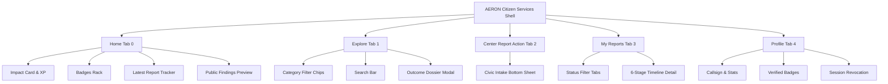

# AERON — CITIZEN SERVICES MOBILE APPLICATION MANUAL
## ARCHITECTURE, WORKFLOWS & OPERATIONAL SPECIFICATION

**Product Identity:** AERON — CITIZEN SERVICES  
**Document Classification:** Technical Architecture & Citizen Services Mobile Manual  
**Application Path:** `userapp/`  
**Platform:** Flutter SDK 3.47+ / Dart 3.13+  
**Target Environments:** Android, iOS, Web, Windows  
**Backend Routes:** `/api/v1/citizen/*`, `/api/v1/public/*`, `/api/v1/auth/*`

---

## 1. Executive Summary & Purpose

AERON Citizen Services is the public-facing mobile experience for municipal residents, community watch volunteers, and civic reporters. Powered by the shared AERON Node.js/MongoDB backend, the Flutter application empowers citizens to:
1. Report local infrastructure hazards, illegal dumping, public safety bottlenecks, and emergency anomalies.
2. Attach localized photographs and device GPS observation coordinates.
3. Track their submitted reports across a server-controlled 6-stage municipal lifecycle.
4. Discover verified public mission outcomes and drone inspection findings.
5. Earn authentic civic contribution scores and verified community achievement badges.

The application strictly reflects the approved Google Stitch visual identity (`stitch_quadcopter_control_interface/aeron_citizen_civic_reporting_verified_outcomes_refined/code.html`).

---

## 2. Security, Authentication & Role Boundaries

### 2.1 Role-Based Access Control (RBAC)
- **Authorized Roles:** `citizen`, `admin`.
- **Blocked Roles:** `manager` accounts attempting to access Citizen endpoints or the mobile application are rejected with `403 FORBIDDEN_ROLE`.
- **Public Endpoints:** Public findings discovery (`/api/v1/public/outcomes`) and municipal statistics (`/api/v1/public/stats`) are publicly accessible without authentication.

### 2.2 Secure Token Storage (`FlutterSecureStorage`)
In strict adherence to mobile security best practices:
- Tokens are **never** stored in plaintext `SharedPreferences` or local web storage.
- Storage uses `FlutterSecureStorage` with Android KeyStore (AES-GCM / RSA OAEP wrapping) and iOS Keychain (`KeychainAccessibility.first_unlock`).
- Short-lived JWT access tokens (15 minutes) and single-use refresh tokens are persisted securely.
- Refresh token rotation is handled automatically on HTTP 401 responses.
- Tokens, passwords, and sensitive keys are never emitted to console application logs.

### 2.3 Strict Hardware & Telemetry Isolation
Citizens are strictly prohibited from accessing:
- Raw flight telemetry streams (`drone:telemetry:*`).
- Low-latency FPV camera feeds (`drone:camera:*`).
- Pixhawk MAVLink flight controller commands (arm, disarm, takeoff, land).
- Subterranean Search & Rescue confidential coordinates (`isConfidential = true`).
- Private reports belonging to other citizens.
- Internal AI diagnostics or model parameters.

All access controls are enforced authoritatively by the backend server.

---

## 3. Approved Visual Identity & Design System

The application strictly adopts the approved Stitch dark tactical design tokens:

| Token Name | Hex Code | Visual Application |
|---|---|---|
| Background | `#131313` | Root view & scaffold background |
| Surface Low | `#1B1C1C` | Primary cards, cards container |
| Surface Container | `#202020` | Modals, bottom navigation dock |
| Surface High | `#2A2A2A` | Interactive inputs, inner bento boxes |
| Surface Highest | `#353535` | Borders, subtle dividers, inactive chips |
| Surface Lowest | `#0E0E0E` | App bar, deep inset viewports |
| Primary Accent | `#BFF42E` | High-voltage lime: active pills, buttons, pulse dots |
| Text Primary | `#FFFFFF` | High-contrast headings and callsigns |
| Text Secondary | `#C6C6C7` | Body descriptions and explanations |
| Text Muted | `#8D937A` | Telemetry metadata, timestamps, coordinates |
| Error / Alert | `#FFB4AB` | Confidential SAR tags, form validation errors |

**Typography:**
- **Display Headings & Badges:** *Anton*
- **Interface & Content:** *Manrope*
- **Telemetry Keys & GPS Coordinates:** *Space Mono* (monospaced)

---

## 4. Five Main Navigation Destinations



### 4.1 Home Screen (`HomeScreen`)
- **Header:** Callsign, pulse indicator, `SEC-NORM` status, PTS counter, notification bell with unread badge, profile avatar.
- **Recent Impact Banner:** Toast acknowledging recently resolved community reports.
- **Zone & Airspace Status:** Sector North // Zone 04 status banner.
- **Citizen Impact Score:** Honest level, circular progress meter, next milestone benchmark.
- **Community Achievement Badges:** Horizontal rack of earned badges (`Community Watch`, `Verified Contributor`, `Civic Advocate`, `Eco Steward`).
- **Primary Action Hero Card:** One-tap trigger opening the civic issue intake sheet.
- **Latest Active Report Journey:** Real-time 6-stage mini timeline tracking the citizen's latest submission.
- **Mission Category Touch Grid (2x2):** Quick dispatch into Road & Structural, Crowd Safety, Micro-Climate, or Search & Rescue.
- **Neighborhood Impact Bento:** Verified monthly reports count and average triage turnaround time.
- **Published Mission Outcomes Preview:** Live cards showcasing confirmed municipal inspection findings.

### 4.2 Explore Screen (`ExploreScreen`)
- Search by keywords or report ID.
- Category filters: `ALL FINDINGS`, `CIVIL INFRA`, `ZONE SAFETY`, `ECO AUDIT`.
- Detail modal rendering full municipal inspection dossiers and public works work order confirmations.
- Strict backend exclusion of confidential SAR missions.

### 4.3 Center Report Action (`CreateReportBottomSheet`)
- Category selector with icon chips.
- Description input with length validation (5 to 1000 characters).
- Geolocation card with GPS acquisition trigger.
- Evidence attachment from Camera or Gallery.
- Duplicate tap prevention and in-flight transmission spinner.
- Confirmation dialog displaying the generated report ID (e.g. `AER-2026-1092`).

### 4.4 My Reports (`MyReportsScreen`)
- Comprehensive ledger of all reports submitted by the logged-in citizen.
- Status filters: `ALL`, `SUBMITTED`, `MUNICIPAL_REVIEW`, `INSPECTION_SCHEDULED`, `AERIAL_VERIFIED`, `RESOLVED`.
- Tapping opens the full 6-stage progression timeline.

### 4.5 Profile Screen (`ProfileScreen`)
- User avatar, name, email, account role (`CITIZEN`).
- Contribution stats: Total Reports, Aerial Verified, Civic Points.
- Verified badges list.
- Callsign update dialog.
- Secure sign-out and global session revocation actions.

---

## 5. 6-Stage Civic Report Progression Lifecycle

Every civic report submitted by a citizen advances through 6 distinct server-controlled milestones:

| Stage # | Stage Key | Description | Responsible Entity |
|---|---|---|---|
| **1** | `SUBMITTED` | Report received and validated by API server. | AERON Platform Intake |
| **2** | `MUNICIPAL_REVIEW` | Triage coordinator reviews description and priority. | Municipal Dispatch Officer |
| **3** | `INSPECTION_SCHEDULED` | Sortie queued for aerial drone mission. | Sector Drone Command Unit |
| **4** | `AERIAL_VERIFIED` | Drone completes overhead survey & photogrammetry. | Aerial Inspection Drone |
| **5** | `PUBLIC_WORKS` | Work order forwarded to ground crew (e.g. asphalt patch). | Public Works Maintenance Crew |
| **6** | `RESOLVED` | Issue resolved in field; +50 Civic Points credited. | Municipal Closeout Authority |

> [!IMPORTANT]
> Stage progression is strictly server-controlled. Citizens cannot manually modify stages, change approval statuses, or award themselves points.

---

## 6. Geolocation & Privacy Protocol

1. **Coordinate Ordering:** All coordinates sent to and received from the backend follow GeoJSON standard: `[longitude, latitude]`.
2. **Observation Coordinate Disclosure:** The mobile application explicitly labels device GPS coordinates as the *citizen observation location*. It does not fabricate or claim that a drone has already verified the coordinates at time of submission.
3. **Graceful Permission Handling:**
   - If GPS permission is denied or device location is disabled, the app falls back cleanly to the Sector 04 municipal reference coordinates (`[77.5946, 12.9716]`).
   - The user is notified of the fallback status.

---

## 7. Evidence Photo Upload Protocol

1. **File Type & Size Restrictions:** Supported MIME types are `image/jpeg`, `image/png`, and `image/webp`. File size must not exceed 5MB.
2. **Storage Decoupling:** Image binaries are never stored directly in MongoDB documents. Metadata is registered in `MediaAsset` collection.
3. **Local Dev vs. Production Storage:**
   - In local development mode, base64 payloads are staged to local media asset references.
   - In production mode, durable cloud object storage (S3/GCS) is required. If unconfigured, production uploads are explicitly blocked (`503 STORAGE_UNAVAILABLE`) rather than claiming successful persistent cloud storage.

---

## 8. Configuration & Startup

### Prerequisites
- Flutter SDK `3.24+` (tested on `3.47.5`)
- Dart `3.13+`
- Running AERON Backend API (`http://localhost:5000`)

### Running the App Locally
```powershell
cd userapp
flutter pub get
flutter analyze
flutter test
flutter run -d chrome # Or target Android / iOS emulator
```

### Targeting Production API
```powershell
flutter run --dart-define=AERON_API_URL=https://aeron-api.sharprad-x.tech/api/v1
```

