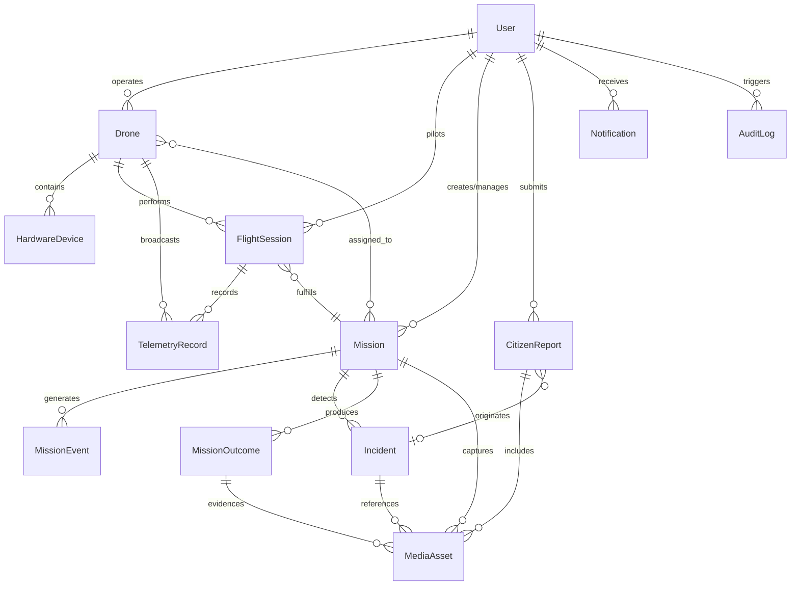

# AERON — Master Database Architecture & Telemetry Persistence

This document specifies the MongoDB database architecture, Mongoose data schemas, indexing strategy, geospatial configurations, and telemetry persistence models for **AERON — Multi-Mission Autonomous Drone Platform**.

---

## 1. Architectural Overview & Design Principles

The AERON data layer powers three unified client applications through a single centralized Node.js/Express backend:
- **Admin Web (`GCS-SYS`):** Real-time hardware telemetry, bus verification, battery dynamics, vector schematics.
- **Manager Web (`GCS v4.2 PRO`):** Mission command, 8-stage operational lifecycles, cross-mission analytics, incident triage.
- **Citizen Mobile App:** Civic hazard intake, 6-stage municipal verification, outcome transparency.

### Core Data Principles

1. **Independent Telemetry Collection:**
   Telemetry points are persisted as independent immutable documents within the `telemetryrecords` collection rather than embedded arrays in `drones` or `flightsessions`. This avoids the MongoDB 16MB document size limit and ensures scalable high-frequency ingestion at 10Hz.
2. **Strict GeoJSON Compliance:**
   All geospatial coordinates strictly follow the GeoJSON standard: `[longitude, latitude]` (`longitude` $\in [-180, 180]$, `latitude` $\in [-90, 90]$). Indexed using MongoDB `2dsphere` indexes.
3. **Decoupled Binary Storage:**
   MongoDB never stores raw image or video binaries. Only metadata, cryptographic checksums, MIME types, storage paths, and entity links are stored in `mediaassets`.
4. **Mission Categorization Integrity:**
   Missions are strictly constrained to 4 canonical categories:
   - `CIVIC_ISSUE_VERIFICATION`
   - `CROWD_SAFETY`
   - `MICRO_CLIMATE`
   - `SUBTERRANEAN_SEARCH_RESCUE`
5. **Confidentiality & Access Segregation:**
   Sensitive coordinates and telemetry gathered during subterranean search & rescue missions are gated via `isConfidential: true` flags on incidents and missions to prevent public exposure.

---

## 2. Entity-Relationship Diagram

---

## 3. Detailed Collection Specifications

The database schema is organized across 13 distinct collections in MongoDB:

### 3.1. `users`
Central user registry supporting Role-Based Access Control (RBAC).

| Field | Type | Required | Description |
|---|---|---|---|
| `_id` | ObjectId | Yes | Internal database primary key |
| `name` | String | Yes | Full display name (2–100 chars) |
| `email` | String | Yes | Unique lowercase email address (Regex validated) |
| `passwordHash` | String | Yes | Bcrypt/Argon2 password hash (`select: false`) |
| `role` | String | Yes | Enum: `'admin'`, `'manager'`, `'citizen'` |
| `accountStatus`| String | Yes | Enum: `'active'`, `'suspended'`, `'pending'` |
| `profileImageUrl` | String | No | Public CDN or asset avatar path |
| `createdAt` | Date | Yes | Auto-managed timestamp |
| `updatedAt` | Date | Yes | Auto-managed timestamp |

- **Indexes:**
  - `{ email: 1 }` (Unique)
  - `{ role: 1 }`
  - `{ accountStatus: 1 }`

---

### 3.2. `drones`
Physical and simulated airframe specifications and operational states.

| Field | Type | Required | Description |
|---|---|---|---|
| `droneId` | String | Yes | Unique airframe code (e.g. `'AERON-HEX-01'`) |
| `displayName` | String | Yes | User-friendly moniker (e.g. `'Apex-Leader'`) |
| `model` | String | Yes | Airframe model name (e.g. `'Tarot 680 Pro Hexacopter'`) |
| `manufacturer`| String | Yes | Airframe integrator name |
| `flightController` | String | Yes | Autopilot specification (e.g. `'Pixhawk 2.4.8'`) |
| `hardwareIdentifiers` | Map/Object | No | Bus IDs, MAC addresses, ESC configurations |
| `operationalStatus` | String | Yes | Enum: `'READY'`, `'IN_FLIGHT'`, `'MAINTENANCE'`, `'OFFLINE'` |
| `lastTelemetryAt` | Date | No | Timestamp of most recent received packet |
| `createdAt` | Date | Yes | Timestamp |
| `updatedAt` | Date | Yes | Timestamp |

- **Indexes:**
  - `{ droneId: 1 }` (Unique)
  - `{ operationalStatus: 1 }`
  - `{ lastTelemetryAt: -1 }`

---

### 3.3. `hardwaredevices`
Component bus inventory (Pixhawk 2.4.8, Ublox NEO-M8N GPS, 4K Gimbal Camera, 4S Power Module).

| Field | Type | Required | Description |
|---|---|---|---|
| `deviceId` | String | Yes | Unique component identifier |
| `droneId` | ObjectId | Yes | Reference to parent `Drone` (`ref: 'Drone'`) |
| `deviceType` | String | Yes | Enum: `'FLIGHT_CONTROLLER'`, `'GPS'`, `'CAMERA'`, `'POWER_MODULE'`, `'ENVIRONMENTAL_SENSOR'`, `'OTHER'` |
| `manufacturer`| String | Yes | Component vendor |
| `model` | String | Yes | Part number / model string |
| `serialNumber`| String | No | Physical serial identifier |
| `installationStatus` | String | Yes | Enum: `'INSTALLED'`, `'NOT_INSTALLED'` |
| `connectionStatus` | String | Yes | Enum: `'CONNECTED'`, `'DISCONNECTED'`, `'UNKNOWN'`, `'ERROR'`, `'AWAITING_DATA'` |
| `lastSeenAt` | Date | No | Heartbeat verification timestamp |
| `metadata` | Mixed | No | Calibration offsets, baud rates, bus addresses |

- **Indexes:**
  - `{ deviceId: 1 }` (Unique)
  - `{ droneId: 1, deviceType: 1 }`
  - `{ connectionStatus: 1 }`

---

### 3.4. `flightsessions`
Individual flight sorties executed by an airframe.

| Field | Type | Required | Description |
|---|---|---|---|
| `flightSessionId` | String | Yes | Unique sortie ID (e.g. `'FS-2026-001'`) |
| `droneId` | ObjectId | Yes | Reference to `Drone` |
| `missionId` | ObjectId | No | Associated `Mission` reference |
| `startedAt` | Date | Yes | Sortie start time |
| `endedAt` | Date | No | Sortie termination time |
| `status` | String | Yes | Enum: `'PLANNED'`, `'ACTIVE'`, `'COMPLETED'`, `'ABORTED'` |
| `source` | String | Yes | Enum: `'REAL'`, `'SIMULATION'` |
| `startLocation` | GeoPoint | No | GeoJSON Point `[lon, lat]` of takeoff |
| `endLocation` | GeoPoint | No | GeoJSON Point `[lon, lat]` of landing |
| `durationSeconds` | Number | Yes | Flight duration in seconds |
| `summary` | String | No | Debriefing remarks |

- **Indexes:**
  - `{ flightSessionId: 1 }` (Unique)
  - `{ droneId: 1, startedAt: -1 }`
  - `{ missionId: 1, startedAt: -1 }`
  - `{ status: 1 }`
  - `{ source: 1 }`

---

### 3.5. `telemetryrecords`
High-frequency normalized MAVLink stream records.

| Field | Type | Required | Description |
|---|---|---|---|
| `droneId` | ObjectId | Yes | Reference to `Drone` |
| `flightSessionId` | ObjectId | No | Reference to `FlightSession` |
| `recordedAt` | Date | Yes | Flight controller GPS timestamp |
| `receivedAt` | Date | Yes | Ground station arrival timestamp |
| `source` | String | Yes | Ingestion bridge ID (e.g. `'MAVLINK_BRIDGE'`) |
| `isSimulated`| Boolean | Yes | Flag distinguishing live flights from simulations |
| `location` | GeoPoint | No | Auto-populated GeoJSON Point `[lon, lat]` |
| `latitude` | Number | No | Decimal latitude ($-90..90$) |
| `longitude`| Number | No | Decimal longitude ($-180..180$) |
| `altitude` | Number | No | Altitude above Mean Sea Level (MSL) |
| `relativeAltitude` | Number | No | Altitude Above Ground Level (AGL) |
| `groundSpeed` | Number | No | Speed in meters/second |
| `heading` | Number | No | Compass heading ($0..360^\circ$) |
| `gpsFixType` | String | No | GPS state (`'3D_FIX'`, `'RTK_FLOAT'`, etc.) |
| `satellites` | Number | No | Visible satellite count |
| `hdop` | Number | No | Horizontal dilution of precision |
| `batteryVoltage` | Number | No | 4S pack terminal voltage ($0..25.2\text{V}$) |
| `batteryCurrent` | Number | No | Amperage draw |
| `batteryPercentage` | Number | No | Remaining capacity ($0..100\%$) |
| `flightMode` | String | No | ArduCopter mode (`'AUTO'`, `'LOITER'`, `'RTL'`, etc.) |
| `armed` | Boolean | Yes | Airframe motor arming state |
| `sensorHealth` | Mixed | No | Bitmask or sub-system statuses |

- **Hooks:**
  - `pre('validate')`: Automatically constructs the GeoJSON `location: { type: 'Point', coordinates: [longitude, latitude] }` whenever valid lat/lon coordinates are passed.
- **Indexes:**
  - `{ droneId: 1, recordedAt: -1 }` (Compound primary lookup)
  - `{ flightSessionId: 1, recordedAt: 1 }` (Flight route reconstruction)
  - `{ location: '2dsphere' }` (Geospatial geofence queries)
  - `{ isSimulated: 1, recordedAt: -1 }` (Sim vs real query segregation)

---

### 3.6. `missions`
Operational deployments across the 4 canonical categories with 8-stage lifecycle tracking.

| Field | Type | Required | Description |
|---|---|---|---|
| `missionId` | String | Yes | Unique mission code (e.g. `'MSN-2026-001'`) |
| `missionType` | String | Yes | Enum: `'CIVIC_ISSUE_VERIFICATION'`, `'CROWD_SAFETY'`, `'MICRO_CLIMATE'`, `'SUBTERRANEAN_SEARCH_RESCUE'` |
| `title` | String | Yes | Mission operational title (3–200 chars) |
| `description` | String | Yes | Operational briefing and task description |
| `status` | String | Yes | Enum: `'PLANNED'`, `'ACTIVE'`, `'PAUSED'`, `'COMPLETED'`, `'CANCELLED'`, `'ABORTED'` |
| `stage` | Number | Yes | Current lifecycle stage ($1..8$) |
| `stageLabel` | String | Yes | Label (e.g. `'STAGE 1/8: MISSION PLANNING'`) |
| `createdBy` | ObjectId | Yes | Reference to commanding User |
| `assignedManager` | ObjectId | No | Reference to managing User |
| `assignedDrones` | ObjectId[] | No | Array of participating airframe IDs |
| `operationalArea`| Polygon/MultiPolygon | No | GeoJSON boundary of flight operation |
| `metadata` | Mixed | No | Mission-specific sensor configs and thresholds |

- **Indexes:**
  - `{ missionId: 1 }` (Unique)
  - `{ missionType: 1, status: 1 }`
  - `{ assignedManager: 1, status: 1 }`
  - `{ operationalArea: '2dsphere' }`

---

### 3.7. `missionevents`
Discrete audit events during mission execution (liftoff, waypoint arrival, geofence warning, landing).

| Field | Type | Required | Description |
|---|---|---|---|
| `missionId` | ObjectId | Yes | Reference to parent `Mission` |
| `eventType` | String | Yes | Type tag (e.g. `'WAYPOINT_REACHED'`, `'ABORT_TRIGGERED'`) |
| `actorId` | ObjectId | No | User triggering or supervising event |
| `eventTimestamp` | Date | Yes | Event occurrence timestamp |
| `description` | String | Yes | Descriptive human-readable log |
| `metadata` | Mixed | No | Telemetry snapshot or error code |
| `source` | String | Yes | Event origin (`'DRONE_BRIDGE'`, `'ADMIN_WEB'`, `'SYSTEM'`) |

- **Indexes:**
  - `{ missionId: 1, eventTimestamp: -1 }`
  - `{ eventType: 1, eventTimestamp: -1 }`

---

### 3.8. `incidents`
Actionable occurrences detected during flight operations or verified citizen hazard reports.

| Field | Type | Required | Description |
|---|---|---|---|
| `incidentId` | String | Yes | Unique incident identifier |
| `missionId` | ObjectId | No | Associated `Mission` reference |
| `incidentType` | String | Yes | Tag (e.g. `'ROAD_DAMAGE'`, `'CROWD_SURGE'`, `'HOTSPOT'`) |
| `severity` | String | Yes | Enum: `'LOW'`, `'MEDIUM'`, `'HIGH'`, `'CRITICAL'` |
| `status` | String | Yes | Enum: `'OPEN'`, `'INVESTIGATING'`, `'MITIGATED'`, `'RESOLVED'`, `'CLOSED'` |
| `description` | String | Yes | Incident report details |
| `location` | GeoPoint | No | GeoJSON Point `[lon, lat]` of occurrence |
| `isConfidential`| Boolean | Yes | True for SAR survivor protection |
| `assignedManager`| ObjectId | No | Manager in charge of incident triage |
| `evidenceAssets` | ObjectId[]| No | Media references documenting incident |

- **Indexes:**
  - `{ incidentId: 1 }` (Unique)
  - `{ severity: 1, status: 1 }`
  - `{ missionId: 1, reportedAt: -1 }`
  - `{ location: '2dsphere' }`

---

### 3.9. `citizenreports`
Crowdsourced citizen complaints and hazard submissions with 6-stage lifecycle progression.

| Field | Type | Required | Description |
|---|---|---|---|
| `reportId` | String | Yes | Unique public report ticket (e.g. `'REP-2026-001'`) |
| `citizenId` | ObjectId | Yes | Submitting citizen reference |
| `category` | String | Yes | Enum: `'ROAD_STRUCTURAL'`, `'CROWD_SAFETY'`, `'MICRO_CLIMATE_ECO'`, `'SEARCH_RESCUE'` |
| `description` | String | Yes | Detailed problem report (5–1000 chars) |
| `location` | GeoPoint | Yes | GeoJSON Point `[lon, lat]` of reported issue |
| `mediaAssets` | ObjectId[] | No | Citizen-uploaded photographic evidence |
| `status` | String | Yes | Enum: `'SUBMITTED'`, `'MUNICIPAL_REVIEW'`, `'INSPECTION_SCHEDULED'`, `'AERIAL_VERIFIED'`, `'PUBLIC_WORKS_ASSIGNED'`, `'RESOLVED'`, `'REJECTED'` |
| `currentStage` | Number | Yes | Stage index ($1..6$) |
| `earnedPoints` | Number | Yes | Gamified civic engagement points (default 25) |
| `submittedAt` | Date | Yes | Time of submission |
| `reviewedAt` | Date | No | Municipal review timestamp |

- **Indexes:**
  - `{ reportId: 1 }` (Unique)
  - `{ citizenId: 1, submittedAt: -1 }`
  - `{ status: 1, category: 1 }`
  - `{ location: '2dsphere' }`

---

### 3.10. `mediaassets`
Metadata-only storage records for images, videos, point clouds, and documents.

| Field | Type | Required | Description |
|---|---|---|---|
| `mediaId` | String | Yes | Unique media identifier |
| `storageProvider`| String | Yes | Enum: `'LOCAL'`, `'S3'`, `'CLOUDINARY'`, `'GCS'` |
| `storageKey` | String | Yes | File path or bucket key |
| `mediaType` | String | Yes | Enum: `'IMAGE'`, `'VIDEO'`, `'THERMAL'`, `'POINT_CLOUD'`, `'DOCUMENT'` |
| `contentType` | String | Yes | MIME type (e.g. `'image/jpeg'`, `'video/mp4'`) |
| `fileSize` | Number | Yes | Size in bytes ($> 0$) |
| `checksum` | String | No | SHA-256 integrity hash |
| `uploadedBy` | ObjectId | Yes | Uploader user ID |
| `relatedEntityType` | String | Yes | Enum: `'CITIZEN_REPORT'`, `'MISSION'`, `'INCIDENT'`, `'MISSION_OUTCOME'` |
| `relatedEntityId` | ObjectId | Yes | Target entity identifier |
| `source` | String | Yes | Enum: `'CITIZEN_UPLOAD'`, `'DRONE_PAYLOAD'`, `'OPERATOR_CAPTURE'` |
| `metadata` | Mixed | No | EXIF data, focal length, altitude, camera tilt |

- **Indexes:**
  - `{ mediaId: 1 }` (Unique)
  - `{ relatedEntityType: 1, relatedEntityId: 1 }`
  - `{ uploadedBy: 1, uploadedAt: -1 }`

---

### 3.11. `missionoutcomes`
Verified municipal findings and mission deliverables published for civic transparency.

| Field | Type | Required | Description |
|---|---|---|---|
| `outcomeId` | String | Yes | Unique outcome document code |
| `missionId` | ObjectId | Yes | Source mission |
| `outcomeType` | String | Yes | Enum: `'CIVIC_INFRASTRUCTURE'`, `'PUBLIC_SAFETY'`, `'ENVIRONMENTAL_AUDIT'`, `'RESCUE_OPERATION'` |
| `summary` | String | Yes | Concise executive summary (5–200 chars) |
| `findings` | String | Yes | Detailed findings and analytical conclusions |
| `evidenceAssets` | ObjectId[] | No | Photos/orthomosaics evidencing findings |
| `reviewStatus` | String | Yes | Enum: `'DRAFT'`, `'PENDING_REVIEW'`, `'APPROVED'`, `'PUBLISHED'`, `'REJECTED'` |
| `isPublic` | Boolean | Yes | Publication flag |
| `publishedAt` | Date | No | Public release timestamp |

- **Indexes:**
  - `{ outcomeId: 1 }` (Unique)
  - `{ reviewStatus: 1, isPublic: 1 }`
  - `{ publishedAt: -1 }`

---

### 3.12. `notifications`
Targeted alerts dispatched to pilots, managers, or citizens.

| Field | Type | Required | Description |
|---|---|---|---|
| `recipientId` | ObjectId | Yes | Target user |
| `title` | String | Yes | Notification heading |
| `message` | String | Yes | Alert body text |
| `category` | String | Yes | Enum: `'SYSTEM'`, `'MISSION'`, `'INCIDENT'`, `'CIVIC_UPDATE'`, `'ACHIEVEMENT'` |
| `readAt` | Date | No | Read receipt timestamp |
| `relatedEntityType` | String | No | Linked entity type |
| `relatedEntityId` | ObjectId | No | Linked entity reference |

- **Indexes:**
  - `{ recipientId: 1, createdAt: -1 }`
  - `{ recipientId: 1, readAt: 1 }`

---

### 3.13. `auditlogs`
Immutable compliance and security trail for high-consequence operations.

| Field | Type | Required | Description |
|---|---|---|---|
| `actorId` | ObjectId | No | User executing action (null if system autonomous) |
| `action` | String | Yes | Action code (e.g. `'MISSION_ABORT_COMMAND'`) |
| `entityType` | String | Yes | Affected entity name |
| `entityId` | String | Yes | Affected entity primary ID |
| `timestamp` | Date | Yes | Exact event timestamp |
| `source` | String | Yes | Enum: `'ADMIN_WEB'`, `'MANAGER_WEB'`, `'CITIZEN_APP'`, `'DRONE_BRIDGE'`, `'SYSTEM'` |
| `metadata` | Mixed | No | Sanitized parameters, client IP, reason |

- **Indexes:**
  - `{ timestamp: -1 }`
  - `{ entityType: 1, entityId: 1 }`
  - `{ actorId: 1, timestamp: -1 }`

---

## 4. Telemetry Ingestion, Indexing & Data Retention

### 4.1. High-Frequency Ingestion (10Hz)
During active flight operations, each airframe sends telemetry packets at 10Hz via MAVLink.
To optimize write throughput and read efficiency:
1. Every record is stored with `{ droneId, recordedAt }` compound index.
2. The pre-validation hook translates decimal `latitude` and `longitude` to GeoJSON Point format.
3. Live socket clients subscribe to rooms partitioned by `flightSessionId` or `droneId` for real-time HUD rendering without querying historical database collections.

### 4.2. Retention and Downsampling Plan
- **Live Flights:** Stored at full 10Hz resolution for the duration of the flight session.
- **Completed Flights ($> 30$ days):** Background job aggregates telemetry into 1-second interval averages for long-term route analysis.
- **Simulation Telemetry:** Filtered via `{ isSimulated: true }` and eligible for automated 14-day TTL expiration.

---

## 5. Security & Verification Summary

1. **Password Protection:** Password hashes are strictly omitted from standard queries (`select: false`).
2. **Confidential Operations:** Subterranean Search & Rescue incidents and missions are explicitly flagged with `isConfidential: true` to prevent data leakage to public citizen endpoints.
3. **Audit Log Immutability:** The `auditlogs` collection disallows updates and deletions (`timestamps: { createdAt: true, updatedAt: false }`).
4. **Offline Validation:** All 13 models are verified via Vitest without requiring a live database connection, validating enum bounds, coordinate ranges, required fields, and schema hooks.

