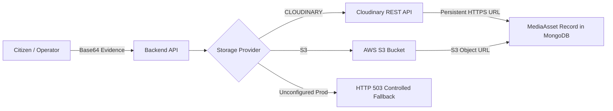

# AERON — Master Production Deployment, Custom Domain & Media Storage Specification

**Document Version:** 2.0.0  
**Classification:** DevOps, Cloud Infrastructure & Production Operations Manual  
**Platform Identity:** AERON — Multi-Mission Autonomous Drone Platform  

---

## 1. Official Domain Architecture

The AERON cloud infrastructure operates across a unified custom domain namespace hosted under `sharprad-x.tech`. All AERON services strictly enforce the mandatory `aeron-` subdomain prefix.

| Service Role | Production URL | Hosting Platform | Source Repository Path | Runtime / Framework |
| :--- | :--- | :--- | :--- | :--- |
| **Backend API & Real-time Engine** | `https://aeron-api.sharprad-x.tech` | **Render Web Service** | `Backend/` | Node.js 20+ / Express / Socket.IO / TypeScript |
| **Admin Web (Drone Intelligence)** | `https://aeron-admin.sharprad-x.tech` | **Cloudflare Pages** | `admin/` | React 18 / Vite / Tailwind CSS / TypeScript |
| **Manager Web (Mission Intelligence)** | `https://aeron-manager.sharprad-x.tech` | **Cloudflare Pages** | `manager/` | React 18 / Vite / Tailwind CSS / TypeScript |
| **Citizen Mobile App** | Mobile Application | **Android APK / iOS IPA** | `userapp/` | Flutter 3.47+ / Material 3 / Dart |
| **Main Portal / Root Website** | `https://sharprad-x.tech` | **Cloudflare Pages / DNS** | `Root / Landing` | Public Gateway & Information Portal |

> [!IMPORTANT]
> **Strict Domain Prefix Rule:**
> Every AERON service subdomain MUST use the `aeron-` prefix (`aeron-api`, `aeron-admin`, `aeron-manager`).
> Legacy names without the prefix (`api.sharprad-x.tech`, `admin.sharprad-x.tech`, `manager.sharprad-x.tech`) are deprecated and MUST NOT be used.
> The root domain `sharprad-x.tech` remains untouched and preserves existing DNS configurations.

---

## 2. Backend Web Service Deployment (Render)

The backend provides REST APIs, machine-to-machine drone ingestion, and authenticated WebSocket telemetry streams.

### 2.1 Service Configuration Parameters
* **Service Type:** Web Service
* **Name:** `aeron-api`
* **Region:** Oregon (US West) or Frankfurt (EU Central)
* **Branch:** `main`
* **Root Directory:** `Backend`
* **Runtime:** `Node` (Node.js >= 20.0.0)
* **Build Command:**
  ```bash
  npm install && npm run build
  ```
  *(Compiles TypeScript source from `Backend/src` into production JavaScript in `Backend/dist`)*
* **Start Command:**
  ```bash
  node dist/server.js
  ```
* **Auto-Deploy:** Yes (or Manual Deploy on release tag)

### 2.2 Network, Reverse Proxy & Port Binding
1. **Dynamic Port Injection:** Render automatically assigns an ephemeral port via `process.env.PORT` (typically 10000). The AERON server dynamically binds to `process.env.PORT || 5000`. Hardcoded ports are strictly avoided.
2. **Reverse Proxy Trust:** The Express application explicitly executes `app.set('trust proxy', 1);` in `Backend/src/app.ts`. This allows proper extraction of client IP addresses and ensures secure cookie propagation behind Render and Cloudflare SSL/TLS termination.
3. **WebSocket Support:** Native WebSocket upgrade is supported out of the box on port 443. Socket.IO automatically negotiates WebSocket transport with HTTP long-polling fallback.

### 2.3 Health Check & Monitoring Endpoints
Configure Render health check settings with the following liveness probe:
* **Health Check Path:** `/health`
* **Liveness Endpoint:** `GET https://aeron-api.sharprad-x.tech/health`
  * Returns `200 OK` with JSON uptime and process metadata:
    ```json
    { "status": "healthy", "service": "AERON Flight & Mission Intelligence API", "uptimeSeconds": 1420 }
    ```
* **Readiness Endpoint:** `GET https://aeron-api.sharprad-x.tech/health/ready`
  * Returns `200 OK` when MongoDB Atlas is connected. Returns `503 Service Unavailable` if the database is unreachable.
* **Integrated Observability:** `GET https://aeron-api.sharprad-x.tech/health/integrated`
  * Returns sanitized status across database, telemetry queue, camera pipeline, and active connections.
* **Admin Diagnostic Endpoint:** `GET https://aeron-api.sharprad-x.tech/api/v1/admin/system/health`
  * Detailed system metrics (requires authenticated `admin` role).

---

## 3. Web Applications Deployment (Cloudflare Pages)

The Admin and Manager web applications are Single Page Applications (SPAs) built with React, Vite, and Tailwind CSS. They are hosted on Cloudflare Pages for ultra-low latency edge delivery.

### 3.1 Admin Web — Drone Intelligence (`aeron-admin.sharprad-x.tech`)
* **Project Name:** `aeron-admin`
* **Root Directory:** `admin`
* **Framework Preset:** `Vite`
* **Build Command:**
  ```bash
  npm install && npm run build
  ```
* **Build Output Directory:** `dist`
* **Environment Variables:**
  ```ini
  VITE_API_BASE_URL=https://aeron-api.sharprad-x.tech/api/v1
  ```
  *(The client automatically derives `SOCKET_URL=https://aeron-api.sharprad-x.tech` from the API URL)*

### 3.2 Manager Web — Mission Intelligence (`aeron-manager.sharprad-x.tech`)
* **Project Name:** `aeron-manager`
* **Root Directory:** `manager`
* **Framework Preset:** `Vite`
* **Build Command:**
  ```bash
  npm install && npm run build
  ```
* **Build Output Directory:** `dist`
* **Environment Variables:**
  ```ini
  VITE_API_BASE_URL=https://aeron-api.sharprad-x.tech/api/v1
  ```

### 3.3 SPA Client-Side Routing (`_redirects`)
To prevent HTTP 404 errors when users refresh deep client-side routes (e.g. `/missions`, `/fleet`, `/reports`, `/map`), both `admin/public/_redirects` and `manager/public/_redirects` contain:
```text
/* /index.html 200
```
During `npm run build`, Vite copies `_redirects` into the `dist/` directory, instructing Cloudflare Pages to rewrite all unknown paths to `index.html` with an HTTP 200 status code.

---

## 4. Cloudflare DNS & SSL/TLS Configuration

Configure the following DNS records within the Cloudflare dashboard for `sharprad-x.tech`:

### 4.1 DNS Records Table
| Type | Name / Host | Target / IPv4 / Value | Proxy Status | TTL | Purpose |
| :--- | :--- | :--- | :--- | :--- | :--- |
| **CNAME** | `aeron-api` | `<your-backend>.onrender.com` | **DNS Only (Gray Cloud)** | Auto | Backend API & WebSocket streams |
| **CNAME** | `aeron-admin` | `<your-admin-project>.pages.dev` | **Proxied (Orange Cloud)** | Auto | Admin Web application |
| **CNAME** | `aeron-manager` | `<your-manager-project>.pages.dev` | **Proxied (Orange Cloud)** | Auto | Manager Web application |

> [!TIP]
> **WebSocket Consideration:** For `aeron-api`, Cloudflare Proxied mode supports WebSockets. However, setting `aeron-api` to **DNS Only** (Gray Cloud) during initial setup avoids Cloudflare WebSocket timeout limits (100 seconds) on idle long-lived telemetry connections.

### 4.2 SSL/TLS Encryption Mode
* Navigate to **SSL/TLS** -> **Overview** in Cloudflare.
* Set encryption mode to **Full** or **Full (Strict)**.
* Enable **Always Use HTTPS** under **SSL/TLS** -> **Edge Certificates**.
* Ensure **Minimum TLS Version** is set to `TLS 1.2` or `TLS 1.3`.

---

## 5. MongoDB Atlas Database Configuration

The AERON persistence layer requires a managed MongoDB Atlas replica set cluster (M0 or higher).

### 5.1 Connection String
The connection URI must target the `aeron` database:
```text
mongodb+srv://<username>:<password>@cluster0.ntom5gm.mongodb.net/aeron?retryWrites=true&w=majority
```

### 5.2 Atlas Network Access (IP Whitelist)
Atlas by default rejects connections from unrecognized IP addresses.
1. Log into [MongoDB Atlas Console](https://cloud.mongodb.com).
2. Select your project and navigate to **Security** -> **Network Access**.
3. Click **Add IP Address**:
   * For Render cloud hosting: Add Render's outbound static IPs (or `0.0.0.0/0` with strong password authentication).
   * For local development: Click **Add Current IP Address** to whitelist your local workstation IP.
4. If an unwhitelisted client attempts to run the seeder or connect, the backend output clearly diagnoses the blocker:
   ```text
   [DEMO-SEED-BLOCKER] Failed to connect to MongoDB.
   Target cluster: MongoDB Atlas (cloud.mongodb.com)
   Root Cause: Your client IP address is not whitelisted in MongoDB Atlas Network Access.
   ```

---

## 6. Durable Media & Evidence Storage (Cloudinary & S3)

In production, drone survey orthomosaics, camera snapshots, and citizen evidence photos must NOT reside on ephemeral container disks or inside MongoDB documents.

### 6.1 Storage Adapter (`StorageService`)
The AERON backend implements a multi-provider storage adapter supporting **Cloudinary** (recommended primary) and **Amazon S3**:



### 6.2 Cloudinary Configuration Steps
1. Create a free account at [Cloudinary](https://cloudinary.com).
2. Retrieve your **Cloud Name**, **API Key**, and **API Secret** from the Dashboard.
3. Configure the following environment variables in Render:
   ```ini
   STORAGE_PROVIDER=CLOUDINARY
   CLOUDINARY_CLOUD_NAME=your_cloud_name
   CLOUDINARY_API_KEY=your_api_key
   CLOUDINARY_API_SECRET=your_api_secret
   ```
4. The backend securely signs upload requests with SHA-1 signatures and delivers assets over Cloudinary's global media CDN.

### 6.3 Media Privacy & Access Authorization Controls
* Raw evidence files are not exposed via unprotected public URLs.
* Access is managed via the authorized endpoint:
  ```http
  GET /api/v1/media/:mediaId
  GET /api/v1/media/:mediaId/content
  ```
* **Privacy Rules Enforced by Backend:**
  * **Search & Rescue (SAR) Mission Media:** Strictly quarantined. Access is restricted to authenticated `admin` and `manager` roles. Unauthorized requests receive `403 FORBIDDEN_MEDIA_ACCESS`.
  * **Citizen Private Evidence:** Accessible only by the uploading citizen, or by operational managers and administrators.
  * **Public Outcomes & Notices:** Verified public outcomes allow unauthenticated retrieval.
* **Controlled Production Fallback:**
  If durable media credentials are not configured in production (`NODE_ENV=production`), upload attempts return a graceful `503 STORAGE_UNAVAILABLE` error instead of corrupting storage or crashing the process.

---

## 7. Master Production Environment Variable Registry

### 7.1 Backend Web Service (`aeron-api`)
| Variable | Mandatory | Default / Example | Purpose |
| :--- | :---: | :--- | :--- |
| `NODE_ENV` | **YES** | `production` | Enables production security checks (32+ char JWT secret, secure cookies) |
| `PORT` | **YES** | Injected by Render (e.g. `10000`) | Dynamic port binding |
| `MONGODB_URI` | **YES** | `mongodb+srv://...` | MongoDB Atlas cluster connection string |
| `JWT_SECRET` | **YES** | 32+ character random hex string | Cryptographic HS256 secret for authentication tokens |
| `JWT_ISSUER` | NO | `aeron-auth` | JWT issuer claim |
| `JWT_AUDIENCE` | NO | `aeron-client` | JWT audience claim |
| `ACCESS_TOKEN_TTL_SECONDS` | NO | `900` | Access token lifetime (15 minutes) |
| `REFRESH_TOKEN_TTL_DAYS` | NO | `7` | Refresh token session persistence window (7 days) |
| `CORS_ORIGIN` | **YES** | `https://aeron-admin.sharprad-x.tech,https://aeron-manager.sharprad-x.tech` | Approved frontend origins |
| `DRONE_BRIDGE_TOKEN` | **YES** | Cryptographic random token | Shared secret for MAVLink telemetry bridge ingestion |
| `CAMERA_BRIDGE_TOKEN` | **YES** | Cryptographic random token | Shared secret for ESP32-CAM frame bridge ingestion |
| `STORAGE_PROVIDER` | **YES** | `CLOUDINARY` | Cloud storage provider (`CLOUDINARY` or `S3`) |
| `CLOUDINARY_CLOUD_NAME` | COND. | `aeron-media` | Cloudinary account identifier |
| `CLOUDINARY_API_KEY` | COND. | Numeric API key | Cloudinary authentication key |
| `CLOUDINARY_API_SECRET` | COND. | Alphanumeric secret | Cloudinary cryptographic secret |
| `LOG_LEVEL` | NO | `info` | Production logging verbosity (`info`, `warn`, `error`) |

### 7.2 Admin Web (`aeron-admin`)
| Variable | Mandatory | Value |
| :--- | :---: | :--- |
| `VITE_API_BASE_URL` | **YES** | `https://aeron-api.sharprad-x.tech/api/v1` |

### 7.3 Manager Web (`aeron-manager`)
| Variable | Mandatory | Value |
| :--- | :---: | :--- |
| `VITE_API_BASE_URL` | **YES** | `https://aeron-api.sharprad-x.tech/api/v1` |

### 7.4 Citizen Mobile Application (`userapp`)
Build command for production APK:
```bash
flutter build apk --release --dart-define=AERON_API_URL=https://aeron-api.sharprad-x.tech/api/v1
```

---

## 8. Smoke Test & Operational Verification Runbook

Execute the following verification checklist post-deployment:

```bash
# 1. Verify Backend Liveness & Uptime
curl -i https://aeron-api.sharprad-x.tech/health

# 2. Verify Database Readiness (MongoDB Atlas Connected)
curl -i https://aeron-api.sharprad-x.tech/health/ready

# 3. Verify Subsystem Observability Matrix
curl -i https://aeron-api.sharprad-x.tech/health/integrated

# 4. Verify CORS Preflight Header
curl -i -X OPTIONS https://aeron-api.sharprad-x.tech/api/v1/auth/login \
  -H "Origin: https://aeron-admin.sharprad-x.tech" \
  -H "Access-Control-Request-Method: POST"

# 5. Verify Storage Diagnostics (Requires Admin Bearer Token)
curl -i https://aeron-api.sharprad-x.tech/api/v1/media/storage/status \
  -H "Authorization: Bearer <ADMIN_JWT_TOKEN>"

# 6. Verify Admin SPA Direct Route Refresh
curl -i https://aeron-admin.sharprad-x.tech/missions
# Must return HTTP 200 with index.html payload (not 404)

# 7. Verify Manager SPA Direct Route Refresh
curl -i https://aeron-manager.sharprad-x.tech/operations
# Must return HTTP 200 with index.html payload (not 404)
```
