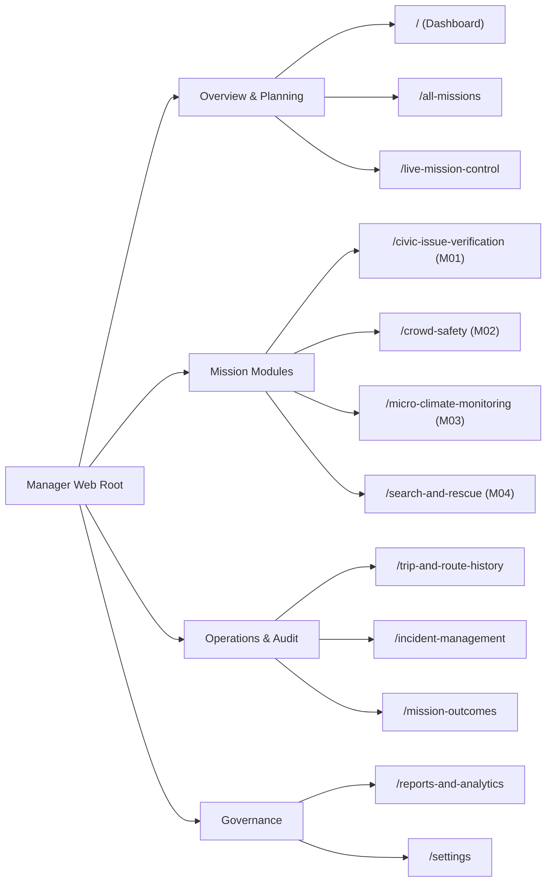
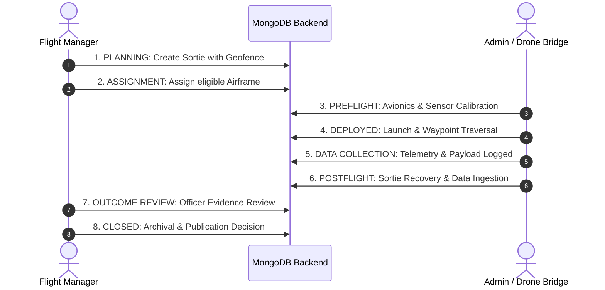

# AERON — MISSION INTELLIGENCE ARCHITECTURE & USER MANUAL

**Product Identity:** AERON — MISSION INTELLIGENCE  
**Document Classification:** Internal Technical Architecture & Mission Operations Specification  
**Application Path:** `manager/`  
**Target URL (Dev):** `http://localhost:5174`  
**Backend Mount:** `Backend/src/routes/manager.routes.ts` (`/api/v1/manager`)

---

## 1. Executive Summary & Purpose

AERON Mission Intelligence is the operational command center designed for municipal flight directors, mission coordinators, and public safety response leads. While the **Admin Web** interface (`admin/`, AERON Drone Intelligence) focuses on hardware telemetry, low-level flight controller avionics, and low-latency FPV video relays, the **Manager Web** interface provides macroscopic mission oversight, lifecycle stage progression, incident audit, and formal outcome review.

The web application is built as a single unified React 18 + Vite + TypeScript application faithfully reproducing the approved Google Stitch dark tactical design specifications (`stitch_quadcopter_control_interface/aeron_manager_mission_operations_outcome_command_refined/code.html`).

---

## 2. Security, Authentication & Role Boundaries

### 2.1 Backend-Enforced Role-Based Access Control (RBAC)
All Manager API routes under `/api/v1/manager` are protected by:
```typescript
requireAuthentication
requireRole('manager', 'admin')
```
- **Allowed Roles:** `manager`, `admin`.
- **Blocked Roles:** `citizen` accounts requesting Manager endpoints immediately receive `403 FORBIDDEN_ROLE`.
- **Unauthenticated Requests:** Blocked with `401 UNAUTHORIZED`.

### 2.2 Client-Side Route Protection (`ProtectedRoute.tsx`)
The React application checks JWT validity and role membership before rendering route components. If an unauthenticated user navigates to any route, they are redirected to `/login`. If an authenticated citizen attempts to log in, an explicit access denial screen is rendered informing the user that citizen accounts must use the Citizen Services Mobile Application.

### 2.3 Strict Separation from Admin Hardware Controls
In accordance with system security boundaries established in Task 04, Task 05, and Task 06:
1. **No Direct Flight Control Commands:** The Manager application cannot issue arm, disarm, takeoff, land, or RTL overrides. Those remain locked in ground control hardware bridges and the Admin interface.
2. **Raw Video Stream Air-Gap:** Real-time raw FPV frames (`drone:camera:*`) are restricted to the Admin GCS. The Manager interface displays verified, bound mission evidence, telemetry breadcrumbs, and authorized snapshots without joining the raw camera stream.

---

## 3. Approved Visual Identity & Design System

The application strictly adopts the approved dark tactical visual language:

| Design Token | Hex Code | Purpose |
|---|---|---|
| Background | `#131313` | Deep tactical dark workspace |
| Primary Surface | `#1B1C1C` | Primary card and container backgrounds |
| Secondary Surface | `#202020` | Nested containers and panels |
| Elevated Surface | `#2A2A2A` | Floating modal dialogs and dropdowns |
| Surface Variant / Border | `#353535` | Subtle dividers and bounding lines |
| Primary Text | `#FFFFFF` | Clear readable headers and high-contrast labels |
| Secondary Text | `#C6C6C7` | Body copy and explanatory guidance |
| Muted Text / Outline | `#8D937A` | Metadata keys, coordinates, timestamps |
| Accent Lime | `#BFF42E` | Tactical focal points, active states, buttons |
| Error / Classified | `#FFB4AB` | Emergency notices, confidential tags, alerts |

**Typography:**
- **Display & Large Callsigns:** Anton
- **User Interface & Body:** Manrope
- **Telemetry, Coordinates & Status:** Space Mono (Monospaced)

---

## 4. 12 Dedicated Navigation Routes



### 4.1 Route Catalog

1. **`/` — Mission Dashboard:**
   - Real-time operational tally: Active Missions, Deployed Fleet, Open Incidents, Verified Outcomes.
   - 4 Mission Module quick-launch cards.
   - Sortable active mission table and live system status indicators.
   - Zero fabricated gamification metrics: Officer levels/XP display honest unconfigured state rather than simulated metrics.

2. **`/all-missions` — All Missions (Sortie Master Directory):**
   - Full paginated table of missions across all categories.
   - Filter by status (`DRAFT`, `SCHEDULED`, `ACTIVE`, `PAUSED`, `COMPLETED`, `CANCELLED`) and category.
   - Search by mission callsign, ID, or description.
   - Mission creation dialog with eligible airframe validation.
   - Manual status progression triggers.

3. **`/live-mission-control` — Tactical GCS / Live Mission Control:**
   - Active sortie selector and real-time mission telemetry viewport.
   - Interactive tactical Leaflet map rendering geofenced operational area, incident coordinates, and airframe location.
   - Stage progression indicator (Stages 1 through 8).
   - Tactical log annotation logger for audit trails.

4. **`/civic-issue-verification` — Civic Issue Verification (M01):**
   - Focus on municipal infrastructure audits (asphalt fissures, illegal dumping, structural defects).
   - Lists M01 sorties and pending civic verification incidents.
   - Direct launch of civic sorties.

5. **`/crowd-safety` — Crowd Safety & Aerial Mesh (M02):**
   - Assembly density monitoring over public gatherings and perimeter routes.
   - Observational threshold metrics (zero simulated panic/stampede claims).
   - Strict adherence to facial privacy standards.

6. **`/micro-climate-monitoring` — Micro-Climate & Heat Island Survey (M03):**
   - Environmental sensor sorties (ambient temperature, humidity, barometric pressure).
   - Explicit physics disclosure: Optical camera telemetry is visible-spectrum and not conflated with radiometric FLIR.

7. **`/search-and-rescue` — Subterranean Search & Rescue Command (M04):**
   - Culvert navigation and beacon localization drills.
   - Confidentiality badge and strict survivor data quarantine.

8. **`/trip-and-route-history` — Trip & Route History (Telemetry Ledger):**
   - Flight session browser with source filters (`REAL` hardware vs `SIMULATED` synthetic).
   - Detailed route reconstruction on tactical Leaflet map.
   - Telemetry sample inspector with altitude, speed, battery, and GPS coordinates.

9. **`/incident-management` — Incident Management & Verification:**
   - Master ledger of field anomalies and citizen-submitted civic reports.
   - Severity filtering (`LOW`, `MEDIUM`, `HIGH`, `CRITICAL`) and lifecycle management (`NEW`, `ASSIGNED`, `UNDER_REVIEW`, `RESOLVED`, `DISMISSED`).
   - Incident assignment and resolution workflow.

10. **`/mission-outcomes` — Mission Outcomes & Public Dissemination:**
    - Officer outcome review queue (`PENDING_REVIEW`, `APPROVED`, `REJECTED`).
    - Staging for citizen release with public summary redaction.
    - **SAR Confidentiality Protection:** Rescues marked confidential cannot be published to citizens.

11. **`/reports-and-analytics` — Reports & Statistical Aggregation:**
    - Flight hours, mission completion rates, category distribution.
    - JSON audit export for regulatory compliance.

12. **`/settings` — Operational Parameters & System Settings:**
    - Profile callsign review, mission dispatch rules, telemetry retention limits, and security protocols.

---

## 5. Mission Lifecycle & 8-Stage Progression

Every operational sortie in AERON follows a strict 8-stage lifecycle:



1. **Stage 1: PLANNING (`PLANNING`)** — Flight corridor defined, boundary vertices specified, mission objectives drafted.
2. **Stage 2: ASSIGNMENT (`ASSIGNMENT`)** — Suitable drone allocated (`READY` status, matching payload capabilities).
3. **Stage 3: PREFLIGHT (`PREFLIGHT`)** — Hardware checks, battery threshold verification (>60%), and comms handshake.
4. **Stage 4: DEPLOYED (`ACTIVE`)** — In-flight operations, waypoint traversal, real-time telemetry streaming.
5. **Stage 5: DATA COLLECTION (`ACTIVE`)** — Specific payload capture (environmental measurements, high-resolution evidence).
6. **Stage 6: POSTFLIGHT ANALYSIS (`COMPLETED`)** — Airframe recovery, sensor download, and automated anomaly collation.
7. **Stage 7: OUTCOME REVIEW (`COMPLETED`)** — Operational manager inspects findings, verifies integrity, and drafts outcome.
8. **Stage 8: CLOSED (`CLOSED` / `ARCHIVED`)** — Formally sealed; eligible non-confidential outcomes published to citizen portal.

---

## 6. Confidentiality & Public Protection Protocol

### 6.1 Survivor Confidentiality Guard (`isConfidential`)
For Subterranean Search & Rescue operations or sensitive public safety emergencies, outcomes have `isConfidential = true`.

The Backend rigorously enforces this constraint in `manager.controller.ts`:
```typescript
if (outcome.isConfidential) {
  return res.status(403).json({
    status: 'error',
    code: 'SAR_CONFIDENTIAL_PROTECTED',
    message: 'Confidential Search & Rescue outcomes cannot be published to public feeds.'
  });
}
```
Attempting to push confidential records to citizen feeds returns `403 SAR_CONFIDENTIAL_PROTECTED` and terminates the request.

---

## 7. Zero Fabricated Gamification Standards

In accordance with strict enterprise governance rules:
- No simulated XP, leveling progression, or fake precision percentages are generated.
- When an operator does not have an external training ledger configured, the UI honestly renders:
  `OPERATOR LEVEL: STANDBY // NO EXTERNAL TRAINING LEDGER CONFIGURED`.
- Telemetry, battery percentages, and flight durations reflect actual persisted MongoDB records.

